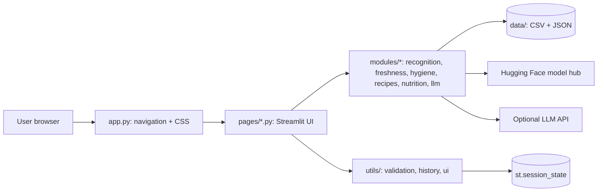

# Food Verse AI: Multimodal Food Intelligence Platform

A Streamlit prototype that combines computer vision (pretrained model + OpenCV), rule-based analysis and optional LLM reasoning across six modules. Built as a B.Tech final-year project MVP.

> **Honesty note.** Only Module A uses a trained model (a public Food-101 classifier; nothing was trained by us). Freshness, hygiene, cooking and nutrition use transparent rule-based logic, and every result is labelled *Actual model output*, *Rule-based estimate* or *Demo data*. Nothing here is medical, nutrition or food-safety advice.

## Modules and implementation status

| Module | What it really does | Limits |
|---|---|---|
| A. Food Recognition | `nateraw/food` ViT (Food-101, 101 classes) via Hugging Face `transformers`; nutrition from a 31-food reference table (shown only if confidence >= 50%) | Only 101 dishes; many cuisines missing; ~340 MB download; needs ~1 GB RAM |
| B. Freshness | HSV colour heuristic: % of dark/brown pixels + saturation, with a red overlay | Not a trained model; brown foods are flagged; cannot detect spoilage or pathogens |
| C. Hygiene | OpenCV frame sampling, Haar-cascade face/upper-body visibility, brightness and blur checks | No glove, hairnet, handwashing or contamination detection; cannot certify hygiene |
| D. Cooking | 12-recipe local library, ingredient matching, diet/cuisine/time/difficulty filters, substitutions; optional LLM (Anthropic API) | Small library; LLM output must be checked |
| E. Nutrition Planner | Mifflin-St Jeor + activity factor; goal adjustments; safety floor (1500 / 1200 kcal); 19-dish allergen-aware plan | Keyword allergy matching in a tiny library; under-18s get maintenance only |
| F. Dashboard | Session history, bar charts, CSV/JSON download, clear history | History is per browser session (lost on refresh) |

## Architecture



```
Food-Verse-AI/
├── app.py                # entry point, sidebar navigation
├── config.py             # settings + secret lookup
├── requirements.txt  .env.example  .gitignore  README.md
├── .streamlit/config.toml
├── pages/                # home, food_recognition, freshness, hygiene, cooking, nutrition, dashboard
├── modules/              # recognition, freshness, hygiene, recipes, nutrition, llm (no UI code)
├── utils/                # validation, history, ui
├── data/                 # nutrition_facts.csv, recipes.json, meals.json
├── tests/test_core.py    # 22 unit tests
└── assets/
```

## Run locally

```bash
# 1. open the extracted folder in VS Code (File > Open Folder), then open its terminal
python -m venv venv
# activate:  Windows: venv\Scripts\activate    macOS/Linux: source venv/bin/activate
pip install -r requirements.txt
streamlit run app.py          # opens http://localhost:8501
```
Python 3.10-3.12 recommended. Want a quick, light install? Delete the last 4 lines of `requirements.txt` (torch/transformers). Module A then only works in **Demo mode**; everything else still works.

## Configuration (optional LLM)

Only the Cooking Assistant's LLM feature needs a key. Locally: copy `.env.example` to `.env`, or set an environment variable (`ANTHROPIC_API_KEY`). On Streamlit Cloud use Secrets (below). Without a key, the app shows a notice and uses the recipe library. Never commit keys; `.gitignore` excludes `.env` and `secrets.toml`.

## Testing

```bash
python -m unittest discover -s tests -v     # or: pip install pytest && pytest
```
Covers validation, nutrition lookup, freshness heuristic, video sampling, recipe filtering, calorie/safety logic, allergen exclusion and history export. **Not covered by automated tests:** the Streamlit pages and the real model download; use the manual cases below.

### Manual test cases
1. **Recognition:** upload a clear pizza photo, expect a label, confidence and calorie range. Upload a `.txt` renamed `.jpg`, expect a "could not read" error. Upload a 20 MB image, expect a size error. Switch to Demo mode, expect a purple "Demo data" badge.
2. **Freshness:** upload a bright red apple and a spotted/brown one; the spotted one should score lower. Upload a white page, expect "not enough colored food area".
3. **Hygiene:** upload a short clip of a person at a counter, expect frame count, person-visible % and annotated frames. Upload a corrupt MP4, expect an error message, not a crash.
4. **Cooking:** `rice, onion, carrot` + Vegetarian, expect Vegetable Fried Rice. Without a key, expect the "LLM off" notice.
5. **Nutrition:** female, 40 kg, Lose weight, expect the 1200 kcal floor warning. Age 15 + Lose weight, expect maintenance-only note. Allergy `dairy, nuts`, expect no paneer/curd/almond dishes.
6. **Dashboard:** run a few modules, check charts, download CSV and JSON, click Clear history.

## Deploy: GitHub + Streamlit Community Cloud

1. **Install Git** (git-scm.com) and create a free GitHub account.
2. **Create the repo:** GitHub > New repository > name `food-verse-ai` > Public (Community Cloud's free tier is easiest with public repos) > do *not* add a README (we have one) > Create.
3. **Push:** in the project folder terminal:
   ```bash
   git init
   git add .
   git commit -m "Initial commit: Food Verse AI"
   git branch -M main
   git remote add origin https://github.com/<your-username>/food-verse-ai.git
   git push -u origin main
   ```
   (GitHub will ask you to sign in or use a personal access token the first time.)
4. **Streamlit Cloud:** go to share.streamlit.io, sign in with GitHub, click **Create app** > deploy from a GitHub repo.
5. Choose **Repository** `<you>/food-verse-ai`, **Branch** `main`, **Main file path** `app.py`.
6. Open **Advanced settings**: choose Python 3.11 or 3.12, and paste secrets if you want the LLM feature:
   ```toml
   ANTHROPIC_API_KEY = "paste-your-key-here"
   ```
7. Click **Deploy**. First build takes several minutes. You get a public `https://<name>.streamlit.app` URL. Visit each page using the sidebar to verify it (Home, then the six modules).
8. **Update later:** `git add . && git commit -m "Update" && git push`. Streamlit redeploys automatically. Secrets can be edited in the app's Settings > Secrets.

Platform limits that matter: the free tier has limited RAM (about 1 GB at the time of writing), apps sleep when idle, and uploaded files and session history are not persisted. Check Streamlit's current docs, since limits change.

## Troubleshooting

| Problem | Fix |
|---|---|
| `ModuleNotFoundError` | Missing from `requirements.txt` or venv not active. Run `pip install -r requirements.txt`. |
| Build fails or app killed ("out of memory") on Cloud | torch + ViT is heavy. Remove the torch/transformers lines and use Demo mode, or set `FOOD_MODEL_ID` to a smaller Food-101 model. |
| Model download fails | Needs internet on first run; retry. The app shows an error and offers Demo mode instead of crashing. |
| Torch install is huge / slow | The `--extra-index-url` line requests the CPU-only build. If your platform ignores it, remove torch lines and use Demo mode. |
| Dependency conflict | Create a fresh venv; relax pins in `requirements.txt`; pick Python 3.11 in Advanced settings. |
| Video will not open | Convert to H.264 MP4 (HandBrake) and keep it under 50 MB. |
| "No ANTHROPIC_API_KEY" | Add it under Settings > Secrets, then reboot the app. |
| Port in use locally | `streamlit run app.py --server.port 8502` |

## Known limitations and next steps
- Not verified on a live Streamlit host from the build environment; follow the manual tests after deploying.
- Fine-tune a freshness classifier on a labelled dataset (e.g. fresh vs rotten fruit) to replace the heuristic.
- Use a trained detector (e.g. YOLO) on a labelled PPE/handwashing dataset for real hygiene checks.
- Replace the small nutrition and meal tables with a reviewed database (USDA FoodData Central, IFCT).
- Add persistent storage with user consent if history must survive refreshes.
